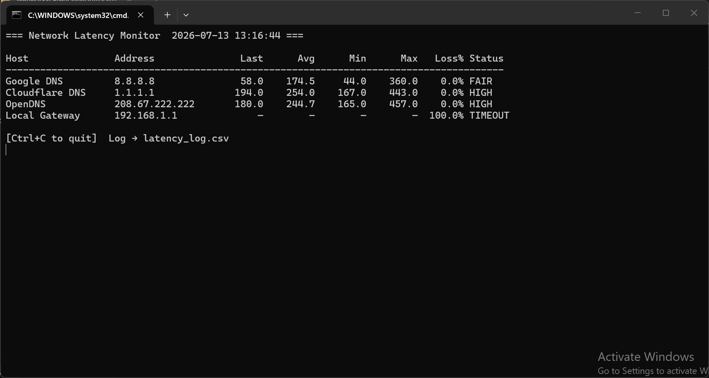

# Network Latency Monitor

A lightweight, real-time, multi-host network latency monitoring and analysis tool written in Python.

It pings several hosts **at the same time** (one thread per host), keeps a rolling window of the last 60 readings for each host, and shows a live dashboard with the **last, average, minimum and maximum latency**, the **packet-loss percentage** and a **status** for every host. Every reading is also saved to a CSV log for later analysis.

No server, no database, no SNMP and no software on the monitored hosts. It runs on **Windows** and **Linux** without administrator rights.



This software was developed for the research project *Design and Implementation of a Real-Time Multi-Host Network Latency Monitoring and Analysis System* by Marcus Blessing Onurawa.

---

## Features

- Concurrent ICMP (ping) probing of any number of hosts
- Rolling statistics over the last 60 readings: last, average, minimum, maximum
- Packet-loss percentage per host
- Status classification:

  | Status  | Meaning                         |
  |---------|---------------------------------|
  | GOOD    | latency below 50 ms             |
  | FAIR    | 50 ms to below 150 ms           |
  | HIGH    | 150 ms or more                  |
  | TIMEOUT | no reply within the timeout     |

- Live terminal dashboard (coloured if the optional `rich` library is installed, plain text otherwise)
- Time-stamped CSV log (`latency_log.csv`)
- Simple JSON configuration (`config.json`), created automatically on first run
- Cross-platform: Windows and Linux (uses the system `ping` command)

---

## Requirements

- Python 3.8 or later
- The operating system's `ping` command (installed by default on Windows and most Linux systems)
- Optional: [`rich`](https://pypi.org/project/rich/) for the coloured dashboard

---

## Installation

### Option 1: Download and run (simplest)

```bash
git clone https://github.com/ibanichukamary4real-cell/latency-system.git
cd latency-system
pip install -r requirements.txt     # optional: installs rich for the coloured table
python latency_monitor.py
```

On Windows, use `py` instead of `python` if `python` is not recognised.

### Option 2: Install as a command

```bash
pip install git+https://github.com/ibanichukamary4real-cell/latency-system.git
latency-monitor
```

Add the coloured dashboard with:

```bash
pip install "network-latency-monitor[rich] @ git+https://github.com/ibanichukamary4real-cell/latency-system.git"
```

---

## Usage

```bash
python latency_monitor.py                         # start monitoring with config.json
python latency_monitor.py --interval 5            # probe every 5 seconds
python latency_monitor.py --no-log                # do not write the CSV log
python latency_monitor.py --config office.json    # use another configuration file
python latency_monitor.py --add-host "Office Router" 192.168.0.1   # add a host and exit
python latency_monitor.py --help                  # show all options
```

Press **Ctrl+C** to stop.

### Command-line options

| Option | Description |
|---|---|
| `--config PATH` | Configuration file to use (default `config.json`) |
| `--interval SECONDS` | Seconds between probes to each host (overrides the config) |
| `--no-log` | Disable CSV logging |
| `--add-host NAME HOST` | Add a host to the configuration and exit |
| `--version` | Show the program version |
| `--help` | Show help |

---

## Configuration

On first run a default `config.json` is created. Edit it to list the hosts you want to monitor:

```json
{
  "interval": 2,
  "timeout": 3,
  "log_to_csv": true,
  "hosts": [
    {"name": "Google DNS", "host": "8.8.8.8"},
    {"name": "Cloudflare DNS", "host": "1.1.1.1"},
    {"name": "OpenDNS", "host": "208.67.222.222"},
    {"name": "Local Gateway", "host": "192.168.1.1"}
  ]
}
```

| Key | Meaning | Default |
|---|---|---|
| `interval` | Seconds between probes to each host | 2 |
| `timeout` | Seconds to wait for a reply | 3 |
| `log_to_csv` | Write readings to `latency_log.csv` | true |
| `hosts` | List of `{ "name": ..., "host": ... }` entries | four default hosts |

**Tip:** change `192.168.1.1` to your own default gateway. On Windows run `ipconfig`; on Linux run `ip route` to find it. Before monitoring, check that each host answers a manual `ping`, because some devices and firewalls block ICMP.

A ready-made example is provided in [`config.example.json`](config.example.json).

---

## Output

### Dashboard columns

| Column | Meaning |
|---|---|
| Host / Address | Friendly name and IP address or host name |
| Last | Latest round-trip time (ms) |
| Avg / Min / Max | Statistics over the last 60 successful readings (ms) |
| Loss% | Lost probes as a percentage of all probes sent |
| Status | GOOD, FAIR, HIGH or TIMEOUT |

### CSV log (`latency_log.csv`)

| Field | Description |
|---|---|
| `timestamp` | Date and time (YYYY-MM-DD HH:MM:SS) |
| `name` | Host name from the configuration |
| `host` | IP address or host name |
| `latency_ms` | Round-trip time in ms (empty if no reply) |
| `status` | `ok` or `timeout` |

Open the log in Excel, LibreOffice or Python (pandas) to compute averages, plot trends or find peak hours.

### Reading the results

| Gateway | Internet hosts | Likely problem location |
|---|---|---|
| GOOD | GOOD | No significant problem |
| GOOD | HIGH / FAIR | Congestion or long path beyond your network |
| GOOD | TIMEOUT (all) | Internet access link or ISP failure |
| HIGH | HIGH | Congestion or fault in the local network |
| TIMEOUT | GOOD | Wrong gateway address in config, or gateway blocks ICMP |
| TIMEOUT | TIMEOUT | Computer disconnected or local network failure |

---

## Running continuously

- **Windows:** create a Task Scheduler task that runs `python C:\LatencyMonitor\latency_monitor.py` at log-on, with "Start in" set to the folder.
- **Linux:** create a systemd service, for example `/etc/systemd/system/latency-monitor.service`:

  ```ini
  [Unit]
  Description=Network Latency Monitor
  After=network-online.target

  [Service]
  WorkingDirectory=/opt/latency-monitor
  ExecStart=/usr/bin/python3 /opt/latency-monitor/latency_monitor.py --no-log
  Restart=on-failure

  [Install]
  WantedBy=multi-user.target
  ```

Archive or rotate `latency_log.csv` from time to time to control its size.

---

## Running the tests

```bash
pip install pytest
python -m pytest -v
```

The tests do not need network access: ping output is simulated for both Windows and Linux.

---

## Security and privacy

- The `ping` command is run with an argument list, never through a shell, so host names in the configuration cannot inject commands.
- Every probe has a timeout, so unresponsive hosts cannot hang the program.
- Runs as an ordinary user; no administrator rights or raw sockets.
- Stores no passwords and collects no user traffic or personal data; only the hosts you configure and their latency are recorded.

---

## Limitations

- Measures ICMP round-trip time only; hosts that block ICMP appear as TIMEOUT.
- Timing comes from the system `ping` utility (about 1 ms resolution; Windows reports sub-millisecond replies as `<1ms`, recorded as 1 ms).
- Monitors from one vantage point (run several copies in different places and combine their logs if needed).

---

## Project structure

```
latency-system/
├── latency_monitor.py        # the program
├── config.example.json       # example configuration
├── requirements.txt          # optional dependency (rich)
├── pyproject.toml            # packaging (pip install)
├── tests/
│   └── test_latency_monitor.py
├── docs/
│   └── sample_output.png
├── .github/workflows/tests.yml   # automatic tests on GitHub
├── LICENSE
└── README.md
```

---

## Licence

MIT. See [LICENSE](LICENSE).
